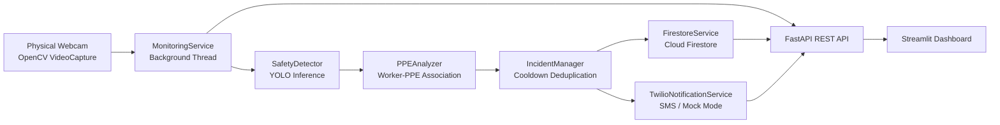

# Sentinel AI — AI-Powered Real-Time Worker Safety Monitoring System


## 1. Project Overview
Sentinel AI is an end-to-end workplace safety monitoring system that connects to a **real physical webcam** (built-in laptop camera or external USB webcam) via OpenCV, runs real-time YOLO object detection, evaluates Personal Protective Equipment (PPE) compliance, logs verified safety incidents to Firebase Cloud Firestore, triggers automated Twilio alerts, and surfaces live telemetry in a dark industrial Streamlit dashboard.

## 2. Problem Statement
Manual safety supervision across construction sites, warehouses, and manufacturing floors cannot scale continuously across shifts. Unnoticed PPE non-compliance—such as missing hard hats or high-visibility vests—increases preventable workplace injuries and delays incident response.

## 3. Motivation
Combining real-time computer vision, clean backend APIs, cloud persistence, and automated alerting demonstrates how edge-to-cloud AI systems can assist safety officers with continuous, auditable monitoring without relying on prerecorded video demos.

## 4. Key Features
- **Real Physical Webcam Integration**: Discovers connected cameras via `cv2.VideoCapture`, supports camera selection, Start/Stop controls, and clean hardware release.
- **Model-Aware AI Detection**: Inspects loaded YOLO `model.names` to distinguish standard COCO `person` detection from custom PPE models (`helmet`, `safety_vest`, `no-helmet`, `no-vest`) without fabricating unsupported detections.
- **PPE Violation Analysis**: Associates detected PPE bounding boxes with workers, computes frame-level safety status (`SAFE`, `WARNING`, `VIOLATION DETECTED`, `CAMERA DISCONNECTED`, `MODEL NOT AVAILABLE`), and enforces configurable cooldowns.
- **FastAPI REST Backend**: Modular Pydantic-validated endpoints with Swagger UI (`/docs`) and clean lifespan shutdown.
- **Firebase Cloud Firestore**: Persistent incident history, date/type filtering, duplicate ID prevention, and safe local fallback when credentials are absent.
- **Twilio Alerting**: Automated SMS notifications with confidence thresholds, cooldowns, and `TWILIO_MOCK_MODE` for safe local testing.
- **Dark Industrial Dashboard**: Streamlit UI with live webcam feed, KPI cards, real-time detection table, incident history, and analytics charts.

## 5. Technology Stack
| Layer | Technology |
| :--- | :--- |
| Language | Python 3.10+ |
| Computer Vision & AI | OpenCV (`VideoCapture`), Ultralytics YOLO |
| Backend API | FastAPI, Uvicorn, Pydantic v2 |
| Database | Firebase Admin SDK, Cloud Firestore |
| Notifications | Twilio REST API |
| Dashboard | Streamlit, Pandas |
| Testing | Pytest, FastAPI TestClient (`httpx`) |

## 6. System Architecture


## 7. Real-Time Webcam Detection Workflow
1. `CameraManager.detect_available_cameras()` probes physical camera indices (`0..5`) and returns only working devices.
2. Clicking **Start Monitoring** calls `POST /api/v1/monitoring/start`, opening `cv2.VideoCapture` and starting a daemon worker thread in `MonitoringService`.
3. Each loop reads a live BGR frame, runs YOLO inference, draws bounding boxes/labels, encodes JPEG bytes for the dashboard, and sleeps according to `FRAME_PROCESS_INTERVAL`.
4. Clicking **Stop Monitoring** or shutting down the backend sets the stop event, joins the thread, and calls `cap.release()`.

## 8. AI Detection Pipeline
`SafetyDetector` (`detection/detector.py`) loads the configured YOLO weights (`YOLO_MODEL_PATH`) and inspects `model.names`:
- If `helmet`/`hardhat` or `vest`/`safety_vest` classes are present, full PPE evaluation is enabled.
- If a COCO-pretrained model like `yolov8n.pt` is used, `SafetyDetector` accurately reports `supports_helmet_detection=False` and `supports_vest_detection=False`, surfacing a `WARNING` status when workers are detected instead of fabricating PPE violations.
- See `models/README.md` for integrating custom-trained PPE `.pt` weights.

## 9. PPE Violation Analysis
`PPEAnalyzer` (`detection/ppe_analyzer.py`) computes spatial overlap between worker bounding boxes and detected PPE items:
- Associates helmets and vests with individual workers (`worker_1`, `worker_2`, ...).
- `IncidentManager` (`detection/incident_manager.py`) tracks `(camera_id, violation_type)` timestamps and suppresses duplicate incident records during `INCIDENT_COOLDOWN_SECONDS`.

## 10. Firebase Architecture & Integration
`firebase/firebase_config.py` loads the service account JSON from `FIREBASE_CREDENTIALS_PATH` (kept outside source control). `FirestoreService` writes unique `INC-*` documents to the `safety_incidents` collection, supports filtering by `violation_type` and `YYYY-MM-DD` date prefix, and updates `notification_status` after Twilio dispatch.

## 11. FastAPI Endpoints
| Method | Endpoint | Description |
| :--- | :--- | :--- |
| `GET` | `/api/v1/health` | Service, model, Firebase, and Twilio readiness |
| `GET` | `/api/v1/monitoring/cameras` | Probe and list available physical webcams |
| `GET` | `/api/v1/monitoring/status` | Live camera, model, and safety status |
| `POST` | `/api/v1/monitoring/start` | Start physical webcam monitoring |
| `POST` | `/api/v1/monitoring/stop` | Stop monitoring and release webcam |
| `GET` | `/api/v1/monitoring/detections` | Latest frame bounding boxes & confidences |
| `GET` | `/api/v1/monitoring/frame` | Latest annotated JPEG frame |
| `POST` | `/api/v1/incidents` | Create an incident record |
| `GET` | `/api/v1/incidents` | Retrieve filtered incident history |
| `GET` | `/api/v1/incidents/stats` | Aggregated incident counts & daily breakdown |
| `GET` | `/api/v1/notifications/status` | Twilio notification counters & status |

## 12. Twilio Notification Workflow
When an incident is generated, `TwilioNotificationService` checks:
1. Confidence >= `TWILIO_MIN_CONFIDENCE`
2. Cooldown elapsed >= `TWILIO_ALERT_COOLDOWN_SECONDS`
3. `TWILIO_MOCK_MODE`: logs simulated alerts locally (`SENT_MOCK`) or dispatches real SMS via Twilio REST API (`SENT` / `FAILED`).

## 13. Dashboard Overview
The Streamlit dashboard (`dashboard/app.py`) uses a dark industrial theme (`#0B0D10` background, charcoal cards, red violation badges) with five sections:
- **Main Monitoring Panel**: Camera selector, Start/Stop buttons, live annotated feed
- **Safety Statistics**: Workers detected, total incidents, helmet/vest violations, status badge
- **Real-Time Detection**: Live detection table and Twilio status
- **Incident History**: Filterable table by violation type and date
- **Analytics**: Daily incident counts, violation category distribution, historical trend

### Screenshots (Add Genuine Captures)
- `screenshots/dashboard_live.png` — *Replace with live webcam monitoring screenshot*
- `screenshots/incident_history.png` — *Replace with incident history screenshot*
- `screenshots/swagger_docs.png` — *Replace with FastAPI `/docs` screenshot*

### Demonstration Video
- *Add link to your genuine screen recording demonstrating physical webcam detection, incident logging, and dashboard updates.*

## 14. Project Directory Structure
```text
Sentinel-AI/
├── backend/
│   ├── main.py
│   ├── routes/
│   │   ├── health.py
│   │   ├── incidents.py
│   │   └── monitoring.py
│   ├── schemas/
│   │   └── models.py
│   └── services/
│       └── monitoring_service.py
├── dashboard/
│   ├── app.py
│   └── components/
│       ├── charts.py
│       └── styles.py
├── detection/
│   ├── camera.py
│   ├── detector.py
│   ├── incident_manager.py
│   └── ppe_analyzer.py
├── docs/
│   └── ARCHITECTURE.md
├── firebase/
│   ├── firebase_config.py
│   └── firestore_service.py
├── models/
│   └── README.md
├── notifications/
│   └── twilio_service.py
├── screenshots/
│   └── README.md
├── tests/
│   ├── test_api.py
│   ├── test_detector_and_ppe.py
│   ├── test_firebase_service.py
│   ├── test_incident_manager.py
│   └── test_twilio_service.py
├── .env.example
├── .gitignore
├── config.py
├── main.py
├── README.md
└── requirements.txt
```

## 15. Prerequisites
- Python **3.10** or **3.11**
- Physical webcam (built-in laptop camera or USB webcam)
- Git
- Optional for cloud features: Firebase project (Firestore enabled) and Twilio account

## 16. Installation & Virtual Environment Setup
```bash
git clone <your-repo-url>
cd Sentinel-AI

# Windows (PowerShell)
python -m venv .venv
.\.venv\Scripts\Activate.ps1

# macOS / Linux
python3 -m venv .venv
source .venv/bin/activate

pip install --upgrade pip
pip install -r requirements.txt
```

## 17. Configuration (Environment Variables, Firebase, Twilio, Webcam)
1. Copy `.env.example` to `.env`:
   ```bash
   cp .env.example .env
   ```
2. **Firebase**: Download your Firebase Admin SDK service account JSON, store it outside git tracking (e.g., `secrets/firebase-service-account.json`), and set `FIREBASE_CREDENTIALS_PATH` in `.env`.
3. **Twilio**: Keep `TWILIO_MOCK_MODE=true` for local testing, or set `TWILIO_MOCK_MODE=false` with valid `TWILIO_ACCOUNT_SID`, `TWILIO_AUTH_TOKEN`, `TWILIO_FROM_NUMBER`, and `TWILIO_TO_NUMBER`.
4. **Webcam Permissions**:
   - **Windows**: Settings → Privacy & security → Camera → Enable desktop app access.
   - **macOS**: System Settings → Privacy & Security → Camera → Allow Terminal / VS Code.
   - **Linux**: Ensure user belongs to the `video` group (`sudo usermod -aG video $USER`).

| Variable | Default | Purpose |
| :--- | :--- | :--- |
| `API_HOST` / `API_PORT` | `127.0.0.1` / `8000` | FastAPI bind address |
| `DEFAULT_CAMERA_INDEX` | `0` | Default physical camera index |
| `YOLO_MODEL_PATH` | `yolov8n.pt` | Path to YOLO `.pt` weights |
| `CONFIDENCE_THRESHOLD` | `0.50` | Minimum detection confidence |
| `INCIDENT_COOLDOWN_SECONDS` | `30` | Deduplication window per camera/violation |
| `FIREBASE_CREDENTIALS_PATH` | `secrets/firebase-service-account.json` | Service account JSON path |
| `TWILIO_MOCK_MODE` | `true` | Simulate SMS alerts locally |

## 18. Running the Application
1. **Verify physical camera**:
   ```bash
   python main.py check-cameras
   ```
2. **Start FastAPI backend** (Terminal 1):
   ```bash
   python main.py backend
   ```
   Swagger documentation is available at `http://127.0.0.1:8000/docs`.
3. **Launch Streamlit dashboard** (Terminal 2):
   ```bash
   python main.py dashboard
   ```

## 19. Running Tests
```bash
pytest -v
```

## 20. Troubleshooting
- **Camera fails to open**: Close Zoom/Teams/browser tabs using the webcam, verify OS camera permissions, and run `python main.py check-cameras`.
- **Helmet/vest violations not triggered with `yolov8n.pt`**: Standard COCO weights do not include PPE classes. Place a custom PPE `.pt` model in `models/` and update `YOLO_MODEL_PATH`.
- **Firebase not connected**: Verify `FIREBASE_CREDENTIALS_PATH` points to an existing JSON file; otherwise the backend safely falls back to in-memory storage.

## 21. Current Limitations & Future Improvements
- Standard COCO weights require a custom-trained PPE model for helmet/vest detection.
- Single-camera stream active per monitoring loop instance (multi-camera async workers can be added in future releases).
- Future enhancements: worker ID tracking (DeepSORT/ByteTrack), RTSP IP camera support, and role-based dashboard authentication.

## 22. Author
Built as a B.Tech Artificial Intelligence & Data Science portfolio project demonstrating real-time computer vision, FastAPI backend engineering, Firebase integration, and automated alerting.
